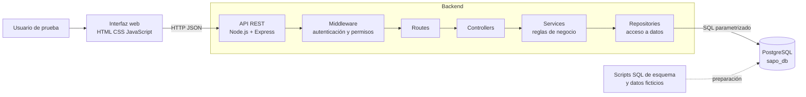

# Arquitectura inicial de S.A.P.O.

## 1. Propósito y alcance

Este documento define la arquitectura lógica prevista para el prototipo académico S.A.P.O. La solución seguirá un modelo cliente-servidor por capas. La arquitectura describe responsabilidades y comunicaciones; no significa que los componentes de software estén ya implementados.

El incremento práctico se limita al circuito simulado de registro y consulta de incidencias asociadas a personas ficticias. No se contemplan conexiones con sistemas policiales, judiciales o administrativos reales ni despliegue en producción.

## 2. Vista lógica de componentes

## 3. Responsabilidades por capa

### Interfaz web

Presenta los formularios y vistas de consulta del prototipo. Recoge entradas del usuario, realiza comprobaciones básicas de interacción y consume la API mediante peticiones HTTP con respuestas JSON. La interfaz no accede directamente a PostgreSQL.

### API REST

Implementada previsiblemente con Node.js y Express. Expone los endpoints del circuito de personas e incidencias, recibe las peticiones de la interfaz y devuelve respuestas HTTP/JSON. La API constituye el límite de entrada al backend.

### Middleware de autenticación y autorización

Comprueba la identidad de la sesión o token y verifica los permisos básicos del perfil de prueba antes de permitir operaciones protegidas. Las comprobaciones efectivas deben realizarse en el servidor; ocultar controles en la interfaz no sustituye a la autorización.

### Controladores y servicios

Los controladores traducen peticiones HTTP a llamadas de aplicación y forman las respuestas. Los servicios concentran las reglas de negocio y coordinan operaciones que pueden afectar a más de una entidad, por ejemplo crear una incidencia y asociarle personas.

### Repositorios y persistencia

Los repositorios encapsulan las consultas y operaciones sobre PostgreSQL. El acceso a datos se realizará desde el backend, con consultas parametrizadas y respetando claves, relaciones y restricciones. La interfaz no tendrá credenciales de base de datos.

### Datos iniciales ficticios

Los scripts de esquema y de carga se mantendrán separados. El diseño del esquema y las dependencias del circuito están documentados en [DATABASE_DESIGN.md](DATABASE_DESIGN.md), que es la única referencia documental del modelo. El orden previsto de carga de datos ficticios está descrito en [database/seeds/README.md](../database/seeds/README.md). La procedencia de los registros locales de ORGANIZACION y TIPO_INCIDENTE sigue pendiente en la [tarea técnica #51](https://github.com/Zanguango/SAPO/issues/51). La existencia de esta documentación no significa que los scripts de esquema o carga estén actualmente versionados ni implementados en el repositorio.

## 4. Flujo principal previsto

1. El usuario de prueba accede a la interfaz web.
2. La interfaz envía una petición a la API REST.
3. El middleware comprueba autenticación y permisos.
4. El controlador valida la forma de la petición y delega el caso de uso al servicio.
5. El servicio aplica reglas de negocio y utiliza uno o varios repositorios.
6. Los repositorios consultan o modifican PostgreSQL.
7. La API devuelve una respuesta HTTP/JSON y la interfaz presenta el resultado.

## 5. Principios y restricciones de diseño

- La interfaz web no se conecta directamente con PostgreSQL.
- Las credenciales y secretos permanecen fuera del código y del control de versiones.
- Las entradas se validan en el servidor y las consultas a base de datos se parametrizan.
- Las reglas de autorización se aplican en el backend.
- Se utilizan únicamente datos ficticios.
- Los registros relacionados necesarios para las pruebas se proporcionan mediante scripts o fixtures en el orden adecuado.
- La arquitectura se mantiene sencilla y proporcional al alcance académico.

## 6. Estado de implementación

En el Sprint 1 se documentan la arquitectura lógica y la estructura inicial del repositorio. En este momento, el backend Node.js/Express, los endpoints, la autenticación y la conexión con PostgreSQL no se consideran implementados por el mero hecho de estar representados en este diseño.
