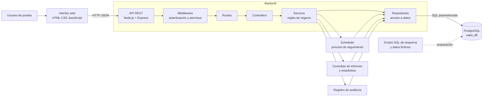

# Arquitectura inicial de S.A.P.O.

## 1. Propósito y alcance

Este documento define la arquitectura lógica prevista para el prototipo académico S.A.P.O. La solución seguirá un modelo cliente-servidor por capas. La arquitectura describe responsabilidades y comunicaciones; no significa que los componentes de software estén ya implementados.

El incremento práctico del 20 % se centra en el circuito simulado de personas e incidencias y contempla además autenticación/permisos básicos, CRUD mínimo de datos generales de la organización, proceso programado de seguimiento sin duplicados, dos reportes, una estadística, auditoría mínima y verificación básica de copia/restauración. Algunas piezas se implementarán en sprints posteriores al Sprint 1; eso no las convierte en alcance futuro fuera de la asignatura. No se contemplan conexiones con sistemas policiales, judiciales o administrativos reales ni despliegue en producción. La matriz vinculante está en [PROJECT_BASELINE.md](PROJECT_BASELINE.md).

## 2. Vista lógica de componentes

## 3. Responsabilidades por capa

### Interfaz web

Presenta los formularios y vistas de consulta del prototipo. Recoge entradas del usuario, realiza comprobaciones básicas de interacción y consume la API mediante peticiones HTTP con respuestas JSON. La interfaz no accede directamente a PostgreSQL.

### API REST

Implementada previsiblemente con Node.js y Express. Expone los endpoints del circuito de personas e incidencias, recibe las peticiones de la interfaz y devuelve respuestas HTTP/JSON. La API constituye el límite de entrada al backend.

### Middleware de autenticación y autorización

Comprueba la identidad de la sesión o token y verifica los permisos básicos del perfil de prueba antes de permitir operaciones protegidas. Las comprobaciones efectivas deben realizarse en el servidor; ocultar controles en la interfaz no sustituye a la autorización.

### Controladores y servicios

Los controladores traducen peticiones HTTP a llamadas de aplicación y forman las respuestas. Los servicios concentran las reglas de negocio y coordinan operaciones que pueden afectar a más de una entidad, por ejemplo crear una incidencia y asociarle personas.

### Repositorios y persistencia

Los repositorios encapsulan las consultas y operaciones sobre PostgreSQL. El acceso a datos se realizará desde el backend, con consultas parametrizadas y respetando claves, relaciones y restricciones. La interfaz no tendrá credenciales de base de datos.

### Programador de tareas y seguimiento

El backend incluirá un proceso programado que revisará los incidentes activos que permanezcan en el estado pendiente durante un umbral configurable. El proceso utilizará un dato verificable del momento en que el incidente entró en ese estado, creará un aviso asociado y registrará la ejecución. Antes de insertar comprobará que no exista un aviso equivalente, para evitar duplicados. No enviará comunicaciones externas. La lógica se implementará en el backend y respetará las restricciones de PostgreSQL.

### Informes y estadística

Los servicios de consulta expondrán los dos reportes mínimos del prototipo: listado de incidencias por periodo/estado y actividad agrupada por tipo con acceso al detalle de cada incidencia, sus personas vinculadas y los datos de seguimiento permitidos. También se proporcionará una estadística agregada por tipo o estado en un periodo. Los resultados se calcularán sobre datos persistidos y se validarán con conjuntos de prueba conocidos.

### Auditoría mínima

Las operaciones relevantes de los flujos comprometidos crearán eventos de auditoría con usuario u origen, fecha/hora, acción, entidad e identificador de registro cuando proceda. Para modificaciones relevantes se conservarán los valores previos y posteriores de campos permitidos. No se registrarán contraseñas, tokens, secretos ni datos sensibles innecesarios. La consulta del histórico completo no forma parte del mínimo del 20 % (SAPO-024, Futuro); si se incorpora en una evolución posterior, deberá limitarse a perfiles autorizados y verificarse en backend.

### Datos iniciales ficticios

Los scripts de esquema y de carga se mantendrán separados. El diseño del esquema y las dependencias del circuito están documentados en [DATABASE_DESIGN.md](DATABASE_DESIGN.md), que es la única referencia documental del modelo. El orden previsto de carga de datos ficticios está descrito en [database/seeds/README.md](../database/seeds/README.md). La procedencia de los registros locales de ORGANIZACION y TIPO_INCIDENTE sigue pendiente en la [tarea técnica #51](https://github.com/Zanguango/SAPO/issues/51). La existencia de esta documentación no significa que los scripts de esquema o carga estén actualmente versionados ni implementados en el repositorio.

## 4. Flujo principal previsto

1. El usuario de prueba accede a la interfaz web.
2. La interfaz envía una petición a la API REST.
3. El middleware comprueba autenticación y permisos.
4. El controlador valida la forma de la petición y delega el caso de uso al servicio.
5. El servicio aplica reglas de negocio y utiliza uno o varios repositorios.
6. Los repositorios consultan o modifican PostgreSQL.
7. La API devuelve una respuesta HTTP/JSON y la interfaz presenta el resultado.

## 5. Principios y restricciones de diseño

- La interfaz web no se conecta directamente con PostgreSQL.
- Las credenciales y secretos permanecen fuera del código y del control de versiones.
- Las entradas se validan en el servidor y las consultas a base de datos se parametrizan.
- Las reglas de autorización se aplican en el backend.
- Se utilizan únicamente datos ficticios.
- Los registros relacionados necesarios para las pruebas se proporcionan mediante scripts o fixtures en el orden adecuado.
- La arquitectura se mantiene sencilla y proporcional al alcance académico.

## 6. Estado de implementación

En el Sprint 1 se han documentado la arquitectura lógica y la estructura inicial del repositorio. En este momento, el backend Node.js/Express, los endpoints, la autenticación, las operaciones CRUD, el scheduler, los informes, la estadística y la conexión con PostgreSQL todavía no están implementados por el mero hecho de estar representados en este diseño. Su desarrollo se distribuirá entre los sprints posteriores según el Product Backlog y la planificación aprobada.
