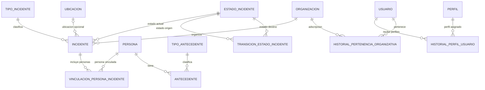

# Modelo de datos del circuito práctico — S.A.P.O.

## 1. Base del análisis y alcance

Para preparar este análisis he revisado los ficheros SAPO_CORREGIDO.sql y SAPO_CORREGIDO_REVISION_ESTATICA.sql. Ambos declaran 24 tablas y 31 claves foráneas; el análisis estático de la versión revisada identifica 40 funciones y 42 triggers. Los dos ficheros no son idénticos: la versión de revisión estática introduce cambios en determinadas funciones y triggers.

El 26/11/2026 he contrastado en pgAdmin 4 la base local sapo_db: he obtenido 24 tablas y 31 claves foráneas, por lo que los recuentos principales coinciden con el fichero de referencia. Esta comprobación no sustituye la comparación exhaustiva de todas las definiciones de columnas, índices, restricciones, funciones y triggers.

El producto completo contempla más entidades, pero el incremento práctico se concentra en el circuito de personas e incidencias. Por ello se distinguen:
- entidades directamente necesarias para el circuito;
- catálogos o entidades vinculadas cuyos registros deben existir antes de ejecutar determinadas operaciones;
- entidades de módulos futuros o condicionales.

## 2. Modelo lógico del circuito

La asociación persona–incidente es de muchos a muchos y se materializa mediante `VINCULACION_PERSONA_INCIDENTE`. Una persona puede tener varias vinculaciones y una incidencia puede incluir varias personas. El tipo de vinculación se almacena como atributo y está limitado por una restricción CHECK; no es una tabla catálogo independiente en el SQL analizado.

## 3. Entidades y relaciones relevantes

| Entidad | Función en el circuito | Claves y restricciones relevantes |
|---|---|---|
| `PERSONA` | Datos de la persona ficticia. | PK `id_persona`; DNI obligatorio; índice único normalizado sobre DNI. |
| `INCIDENTE` | Registro principal del circuito. | PK `id_incidente`; FKs obligatorias a organización, tipo y estado; FK opcional a ubicación. |
| `VINCULACION_PERSONA_INCIDENTE` | Asociación de personas e incidencias y su rol. | PK `id_vinculacion`; FKs obligatorias a persona e incidente; CHECK de tipo; índice único parcial para evitar duplicar una vinculación activa. |
| `ORGANIZACION` | Contexto organizativo requerido por la incidencia. | PK `id_organizacion`; nombre único. |
| `TIPO_INCIDENTE` | Catálogo de tipos de incidencia. | PK `id_tipo_incidente`; nombre único normalizado. |
| `ESTADO_INCIDENTE` | Catálogo de estados permitidos. | PK `id_estado_incidente`; código único y normalizado; orden no negativo. |
| `TRANSICION_ESTADO_INCIDENTE` | Catálogo de transiciones permitidas entre estados. | PK `id_transicion`; FKs al estado de origen y destino; par origen/destino único. |
| `UBICACION` | Catálogo opcional de ubicación. | PK `id_ubicacion`; nombre único normalizado; la FK desde INCIDENTE admite NULL. |
| `USUARIO` | Identidad para autenticación. | PK `id_usuario`; username y email únicos normalizados; `password_hash` obligatorio. |
| `PERFIL` | Catálogo de perfiles funcionales. | PK `id_perfil`; código único. El SQL inserta ADMINISTRADOR, SUPERVISOR y AGENTE. |
| `HISTORIAL_PERFIL_USUARIO` | Asignación temporal de perfiles a usuarios. | FKs obligatorias a usuario y perfil; fechas válidas y periodos no solapados para usuario/perfil. |
| `ANTECEDENTE` | Antecedente ficticio vinculado a persona, si resulta necesario. | FKs obligatorias a persona y tipo de antecedente; estado restringido a PENDIENTE, VIGENTE o ANULADO. |
| `TIPO_ANTECEDENTE` | Catálogo de tipos de antecedentes. | PK `id_tipo_antecedente`; nombre único normalizado. |

## 4. Dependencias funcionales y datos previos

### 4.1 Alta de una incidencia

La tabla `INCIDENTE` declara como NOT NULL:
- `id_organizacion`;
- `id_tipo_incidente`;
- `id_estado_incidente`.

Por tanto, para registrar una incidencia deben existir previamente una organización, un tipo de incidencia y un estado. `id_ubicacion` es opcional y solo requiere una fila de UBICACION cuando se informa.

**Implicación de alcance:** aunque el CRUD de organización no forma parte del incremento práctico, debe existir al menos una organización ficticia de referencia para que el alta de incidencias sea posible. Lo mismo aplica al catálogo de tipos de incidencia. No se necesita implementar un módulo de administración de esos catálogos para suministrar los datos básicos.

### 4.2 Asociación de personas e incidencias

Para insertar en `VINCULACION_PERSONA_INCIDENTE` deben existir previamente:
- una fila de `PERSONA`;
- una fila de `INCIDENTE`.

El campo `tipo_vinculacion` debe pertenecer al conjunto permitido por el CHECK: VICTIMA, AFECTADO, PERJUDICADO, DENUNCIANTE, TESTIGO, INVESTIGADO, DETENIDO, PRESUNTO_AUTOR, REPRESENTANTE, SOLICITANTE, AGENTE_ACTUANTE u OTRO.

La unicidad parcial impide repetir la misma combinación activa de persona, incidencia y tipo de vinculación, pero permite mantener vinculaciones históricas inactivas.

### 4.3 Consulta opcional de antecedentes

Si la consulta de antecedentes se incorpora al circuito, cada antecedente requiere una persona y un tipo de antecedente existentes. Por tanto, `PERSONA` y `TIPO_ANTECEDENTE` deben estar disponibles antes de insertar `ANTECEDENTE`.

### 4.4 Autenticación y perfiles

El SQL define perfiles base, usuarios y el historial temporal de perfiles:
- el script inserta los perfiles ADMINISTRADOR, SUPERVISOR y AGENTE;
- cada usuario de prueba necesita username, email y password_hash;
- la asociación de perfil se registra en `HISTORIAL_PERFIL_USUARIO`, que requiere un usuario y un perfil existentes.

El hash de contraseña debe generarse con el mecanismo seguro que se seleccione para el backend; no se deben sembrar contraseñas en texto plano.

## 5. Datos iniciales que ya contempla el SQL analizado

El fichero `SAPO_CORREGIDO_REVISION_ESTATICA.sql` contiene inserciones para:
- `PERFIL`: ADMINISTRADOR, SUPERVISOR y AGENTE.
- `ESTADO_INCIDENTE`: REGISTRADO, EN_GESTION, PENDIENTE y RESUELTO.
- `TRANSICION_ESTADO_INCIDENTE`: cinco transiciones entre los estados anteriores.

En los ficheros SQL revisados no he encontrado inserciones iniciales para ORGANIZACION, TIPO_INCIDENTE, UBICACION, PERSONA, INCIDENTE, USUARIO ni TIPO_ANTECEDENTE. Sin embargo, al comprobar mi instancia local el 26/11/2026 he observado que ya existen 1 organización y 7 tipos de incidente. Por tanto, esos registros se incorporaron mediante una preparación previa o una carga distinta de los dos ficheros revisados. Antes de recrear la base debo identificar y versionar el origen para poder reproducir el entorno. La instancia también contiene 4 estados y 5 transiciones, que sí están insertados por el SQL de referencia.

## 6. Entidades fuera del núcleo del incremento

El esquema contiene además unidades organizativas, historial de pertenencia organizativa, asignaciones de incidentes, documentos asociados, avisos de seguimiento, auditoría, ejecución de procesos, alertas técnicas, actuaciones de alerta y configuración de umbrales. Se mantienen en el modelo global del producto, pero no deben provocar que el Sprint 1 amplíe el alcance del circuito práctico.

Por ejemplo:
- `UNIDAD_ORGANIZATIVA` requiere una `ORGANIZACION`.
- `ASIGNACION_INCIDENTE` requiere un incidente y exactamente uno de estos destinatarios: usuario o unidad.
- `DOCUMENTO_ASOCIADO` requiere exactamente uno de los destinos permitidos: incidente, persona o antecedente.

## 7. Comprobación de la instancia local — 26/11/2026

He ejecutado una consulta en pgAdmin 4 conectado a sapo_db. He comprobado que la base utiliza el esquema public y PostgreSQL 18.7 (64 bits). Los recuentos obtenidos son:

| Indicador | Resultado local | Resultado del SQL de referencia |
|---|---:|---:|
| Tablas | 24 | 24 |
| Claves foráneas | 31 | 31 |

También he verificado los registros de referencia:

| Tabla | Filas locales |
|---|---:|
| ORGANIZACION | 1 |
| TIPO_INCIDENTE | 7 |
| ESTADO_INCIDENTE | 4 |
| TRANSICION_ESTADO_INCIDENTE | 5 |
| PERSONA | 0 |
| INCIDENTE | 0 |

Los recuentos de tablas y FKs coinciden. Esta verificación es estructural por recuentos y no demuestra que todas las columnas, índices, restricciones y triggers sean idénticos a los del fichero analizado.

ORGANIZACION y TIPO_INCIDENTE tienen datos en mi instancia local, aunque no aparecen insertados en los dos ficheros SQL que he revisado. Debo localizar el script o procedimiento previo que los creó, o preparar una carga versionada equivalente antes de recrear la base.

## 8. Verificaciones pendientes

- Comparar definiciones concretas de columnas, índices, restricciones, funciones y triggers de la instancia local con el SQL de referencia.
- Identificar o reconstruir la carga que proporcionó la organización y los siete tipos de incidente ya presentes.
- Preparar datos ficticios de personas e incidencias cuando el flujo funcional y las reglas de negocio estén definidos.

## 9. Comparación de versiones SQL

He documentado la comparación completa de los cuatro ficheros, sus diferencias de funciones y triggers y sus inserciones iniciales en [docs/SQL_REVIEW_SPRINT1.md](SQL_REVIEW_SPRINT1.md).

## 10. Fuente de análisis

Ficheros analizados: SAPO_CORREGIDO.sql y SAPO_CORREGIDO_REVISION_ESTATICA.sql. El 26/11/2026 he comprobado en pgAdmin los recuentos de la instancia local sapo_db. El análisis y la comprobación quedan limitados a los indicadores expresamente documentados; no afirmo una comparación exhaustiva de todos los objetos SQL.
