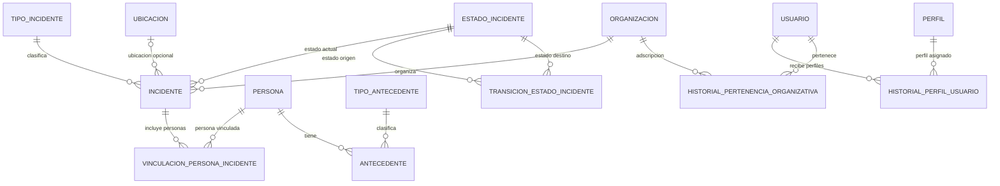

# Modelo de datos del circuito práctico — S.A.P.O.

## 1. Base del análisis y alcance

Este análisis se ha realizado sobre el fichero SQL de referencia `SAPO_CORREGIDO_REVISION_ESTATICA.sql`, que contiene 24 tablas y 31 claves foráneas. Se ha contrastado estructuralmente con `SAPO_CORREGIDO.sql`: ambos ficheros mantienen las mismas tablas y relaciones declaradas, mientras que la versión de revisión estática incorpora ajustes en determinadas funciones y triggers.

**Pendiente de verificación:** antes de generar o ejecutar scripts de carga, se debe comprobar en pgAdmin que el esquema instalado en la base local `sapo_db` corresponde a la versión revisada analizada. Este documento no afirma haber consultado directamente la instancia local.

El producto completo contempla más entidades, pero el incremento práctico se concentra en el circuito de personas e incidencias. Por ello se distinguen:
- entidades directamente necesarias para el circuito;
- catálogos o entidades vinculadas cuyos registros deben existir antes de ejecutar determinadas operaciones;
- entidades de módulos futuros o condicionales.

## 2. Modelo lógico del circuito



La asociación persona–incidente es de muchos a muchos y se materializa mediante `VINCULACION_PERSONA_INCIDENTE`. Una persona puede tener varias vinculaciones y una incidencia puede incluir varias personas. El tipo de vinculación se almacena como atributo y está limitado por una restricción CHECK; no es una tabla catálogo independiente en el SQL analizado.

## 3. Entidades y relaciones relevantes

| Entidad | Función en el circuito | Claves y restricciones relevantes |
|---|---|---|
| `PERSONA` | Datos de la persona ficticia. | PK `id_persona`; DNI obligatorio; índice único normalizado sobre DNI. |
| `INCIDENTE` | Registro principal del circuito. | PK `id_incidente`; FKs obligatorias a organización, tipo y estado; FK opcional a ubicación. |
| `VINCULACION_PERSONA_INCIDENTE` | Asociación de personas e incidencias y su rol. | PK `id_vinculacion`; FKs obligatorias a persona e incidente; CHECK de tipo; índice único parcial para evitar duplicar una vinculación activa. |
| `ORGANIZACION` | Contexto organizativo requerido por la incidencia. | PK `id_organizacion`; nombre único. |
| `TIPO_INCIDENTE` | Catálogo de tipos de incidencia. | PK `id_tipo_incidente`; nombre único normalizado. |
| `ESTADO_INCIDENTE` | Catálogo de estados permitidos. | PK `id_estado_incidente`; código único y normalizado; orden no negativo. |
| `TRANSICION_ESTADO_INCIDENTE` | Catálogo de transiciones permitidas entre estados. | PK `id_transicion`; FKs al estado de origen y destino; par origen/destino único. |
| `UBICACION` | Catálogo opcional de ubicación. | PK `id_ubicacion`; nombre único normalizado; la FK desde INCIDENTE admite NULL. |
| `USUARIO` | Identidad para autenticación. | PK `id_usuario`; username y email únicos normalizados; `password_hash` obligatorio. |
| `PERFIL` | Catálogo de perfiles funcionales. | PK `id_perfil`; código único. El SQL inserta ADMINISTRADOR, SUPERVISOR y AGENTE. |
| `HISTORIAL_PERFIL_USUARIO` | Asignación temporal de perfiles a usuarios. | FKs obligatorias a usuario y perfil; fechas válidas y periodos no solapados para usuario/perfil. |
| `ANTECEDENTE` | Antecedente ficticio vinculado a persona, si resulta necesario. | FKs obligatorias a persona y tipo de antecedente; estado restringido a PENDIENTE, VIGENTE o ANULADO. |
| `TIPO_ANTECEDENTE` | Catálogo de tipos de antecedentes. | PK `id_tipo_antecedente`; nombre único normalizado. |

## 4. Dependencias funcionales y datos previos

### 4.1 Alta de una incidencia

La tabla `INCIDENTE` declara como NOT NULL:
- `id_organizacion`;
- `id_tipo_incidente`;
- `id_estado_incidente`.

Por tanto, para registrar una incidencia deben existir previamente una organización, un tipo de incidencia y un estado. `id_ubicacion` es opcional y solo requiere una fila de UBICACION cuando se informa.

**Implicación de alcance:** aunque el CRUD de organización no forma parte del incremento práctico, debe existir al menos una organización ficticia de referencia para que el alta de incidencias sea posible. Lo mismo aplica al catálogo de tipos de incidencia. No se necesita implementar un módulo de administración de esos catálogos para suministrar los datos básicos.

### 4.2 Asociación de personas e incidencias

Para insertar en `VINCULACION_PERSONA_INCIDENTE` deben existir previamente:
- una fila de `PERSONA`;
- una fila de `INCIDENTE`.

El campo `tipo_vinculacion` debe pertenecer al conjunto permitido por el CHECK: VICTIMA, AFECTADO, PERJUDICADO, DENUNCIANTE, TESTIGO, INVESTIGADO, DETENIDO, PRESUNTO_AUTOR, REPRESENTANTE, SOLICITANTE, AGENTE_ACTUANTE u OTRO.

La unicidad parcial impide repetir la misma combinación activa de persona, incidencia y tipo de vinculación, pero permite mantener vinculaciones históricas inactivas.

### 4.3 Consulta opcional de antecedentes

Si la consulta de antecedentes se incorpora al circuito, cada antecedente requiere una persona y un tipo de antecedente existentes. Por tanto, `PERSONA` y `TIPO_ANTECEDENTE` deben estar disponibles antes de insertar `ANTECEDENTE`.

### 4.4 Autenticación y perfiles

El SQL define perfiles base, usuarios y el historial temporal de perfiles:
- el script inserta los perfiles ADMINISTRADOR, SUPERVISOR y AGENTE;
- cada usuario de prueba necesita username, email y password_hash;
- la asociación de perfil se registra en `HISTORIAL_PERFIL_USUARIO`, que requiere un usuario y un perfil existentes.

El hash de contraseña debe generarse con el mecanismo seguro que se seleccione para el backend; no se deben sembrar contraseñas en texto plano.

## 5. Datos iniciales que ya contempla el SQL analizado

El fichero `SAPO_CORREGIDO_REVISION_ESTATICA.sql` contiene inserciones para:
- `PERFIL`: ADMINISTRADOR, SUPERVISOR y AGENTE.
- `ESTADO_INCIDENTE`: REGISTRADO, EN_GESTION, PENDIENTE y RESUELTO.
- `TRANSICION_ESTADO_INCIDENTE`: cinco transiciones entre los estados anteriores.

En el fichero analizado no se han encontrado inserciones iniciales para ORGANIZACION, TIPO_INCIDENTE, UBICACION, PERSONA, INCIDENTE, USUARIO ni TIPO_ANTECEDENTE. Estos datos deben suministrarse mediante un mecanismo separado cuando se prepare el entorno de pruebas.

## 6. Entidades fuera del núcleo del incremento

El esquema contiene además unidades organizativas, historial de pertenencia organizativa, asignaciones de incidentes, documentos asociados, avisos de seguimiento, auditoría, ejecución de procesos, alertas técnicas, actuaciones de alerta y configuración de umbrales. Se mantienen en el modelo global del producto, pero no deben provocar que el Sprint 1 amplíe el alcance del circuito práctico.

Por ejemplo:
- `UNIDAD_ORGANIZATIVA` requiere una `ORGANIZACION`.
- `ASIGNACION_INCIDENTE` requiere un incidente y exactamente uno de estos destinatarios: usuario o unidad.
- `DOCUMENTO_ASOCIADO` requiere exactamente uno de los destinos permitidos: incidente, persona o antecedente.

## 7. Verificación pendiente en la instancia local

Para contrastar que `sapo_db` contiene la estructura esperada, ejecutar en pgAdmin, conectado a la base de datos y al esquema correspondiente:

```sql
SELECT COUNT(*) AS total_tablas
FROM information_schema.tables
WHERE table_schema = current_schema()
  AND table_type = 'BASE TABLE';

SELECT COUNT(*) AS total_claves_foraneas
FROM information_schema.table_constraints
WHERE constraint_schema = current_schema()
  AND constraint_type = 'FOREIGN KEY';
```

El fichero SQL analizado declara 24 tablas y 31 claves foráneas. Que los recuentos coincidan es una primera comprobación estructural; no sustituye a comparar definiciones concretas de columnas, restricciones, índices y triggers.

## 8. Fuente de análisis

Fichero analizado: `SAPO_CORREGIDO_REVISION_ESTATICA.sql` (versión revisada de 24 tablas y 31 FKs). El análisis se limita al contenido de ese archivo; la coincidencia exacta con la instancia local debe verificarse antes de ejecutar scripts de datos iniciales.
